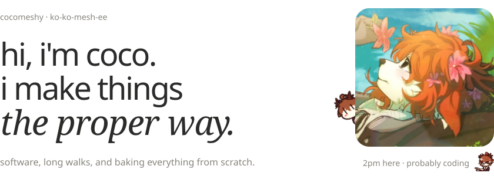
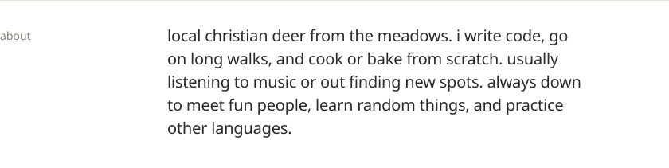

<picture>
  <source media="(prefers-color-scheme: dark)" srcset="./assets/hero-dark.svg">
  
</picture>

<picture>
  <source media="(prefers-color-scheme: dark)" srcset="./assets/stats-dark.svg">
  
</picture>

<picture>
  <source media="(prefers-color-scheme: dark)" srcset="./assets/about-dark.svg">
  
</picture>

<a href="https://www.last.fm/user/cocomeshy">
  <picture>
    <source media="(prefers-color-scheme: dark)" srcset="./assets/music-dark.svg">
    
  </picture>
</a>

  

<a href="https://discord.com/users/1433331742852255919"><picture><source media="(prefers-color-scheme: dark)" srcset="./assets/link-discord-dark.svg"></picture></a>&nbsp;
<a href="https://t.me/cocomeshy"><picture><source media="(prefers-color-scheme: dark)" srcset="./assets/link-telegram-dark.svg"></picture></a>&nbsp;
<a href="https://www.last.fm/user/cocomeshy"><picture><source media="(prefers-color-scheme: dark)" srcset="./assets/link-lastfm-dark.svg"></picture></a>
